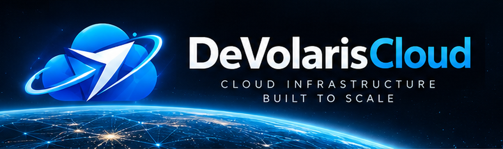

<p align="center"></p>
<h1 align="center">DeVolaris Cloud</h1>
<p align="center"><strong>Secure. Scalable. Connected.</strong></p>
<p align="center">Cloud Infrastructure Built to Scale.</p>
<p align="center"><a href="https://devolaris.cloud">Website</a> · <a href="https://github.com/DeVolaris">DeVolaris Group</a> · <a href="https://t.me/DeVolaris">Contact</a></p>

---

## Infrastructure without uncertainty

**DeVolaris Cloud** is the cloud and managed infrastructure brand of **[DeVolaris Group](https://github.com/DeVolaris)**. We focus on dependable foundations for websites, applications, services, data, and growing businesses.

Our direction combines **security, reliability, automation, observability and transparent infrastructure operations**.

## Platform directions

| Service area | Focus |
|---|---|
| Compute | VPS/VDS and virtualized server workloads |
| Hosting | Web hosting and application environments |
| Storage & Backup | Protected data, retention and recovery architecture |
| Networking | DNS, networking, connectivity and controlled access |
| Security | Infrastructure hardening, isolation and monitoring |
| Managed DevOps | CI/CD, deployment automation and operational support |
| AI Infrastructure | Infrastructure and integrations for AI-enabled applications |

> **Product availability:** These are platform directions and engineering capabilities, not a declaration that each service is live or generally available. Confirm available products and SLAs on the official website.

## Engineering approach

```text
Customer experience
       ↓
Cloud portal / API / Billing
       ↓
Automated provisioning and lifecycle management
       ↓
Compute · Storage · Networking · Security
       ↓
Monitoring · Backups · Support · Governance
```

## Technology areas

Linux · Virtualization · Proxmox · Containers · Docker · Kubernetes · Terraform · Ansible · CI/CD · Monitoring · API integration

*Technology names describe architectural areas under consideration or development, not a verified production deployment inventory.*

## Built for

- Businesses modernizing their infrastructure
- Development teams shipping applications
- Digital platforms planning for scalable operations
- Organizations that need managed infrastructure expertise

## Ecosystem & contact

**Parent brand:** [DeVolaris Group](https://github.com/DeVolaris)  
**Website:** https://devolaris.cloud  
**Business email:** ceo@devolaris.com  
**Telegram:** https://t.me/DeVolaris

<sub>DeVolaris Cloud · Secure. Scalable. Connected.</sub>
